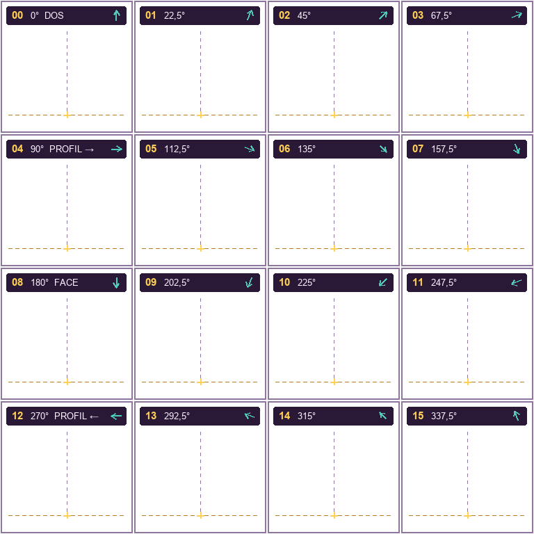

# Midnight Monsters

Le jeu est un site statique en JavaScript avec un rendu Canvas 2D. Dessiner les personnages et les décors dans un éditeur graphique ou un outil d’illustration. Les PNG de `sprites/` contiennent les dessins terminés. Les seize pilotes utilisent tous une planche `turntable.png` de 4 × 4 vues et son index `turntable.json` dans `sprites/players/<id>/`. Le jeu charge directement les fichiers livrés.

## Lancer et jouer

Depuis la racine du projet, dans le dossier qui contient `index.html`, démarrer le serveur avec Python 3.

```sh
python3 -m http.server 8642 --bind 127.0.0.1
```

Ouvrir le jeu dans un navigateur. Si le serveur du projet tourne déjà sur ce port, utiliser le même. Les modifications sont visibles après rechargement. [Jouer](http://localhost:8642/)

Au démarrage, le jeu reprend la langue choisie dans les options. Sans choix enregistré, il parcourt les langues du navigateur par ordre de préférence et utilise la première traduction disponible. Les variantes régionales sont reconnues, par exemple le français canadien et le chinois simplifié de Singapour. L’anglais sert de repli.

À l’accueil, le bouton de jeu ou Entrée ouvre le garage. Les commandes au clavier et au toucher sont accessibles depuis le même écran. Dans les options, choisir English, Français, 日本語, 简体中文 ou Español. La langue change immédiatement. Le jeu mémorise ce choix, le son et le filtre pixel dans le navigateur. Le bouton de retour ou Échap ferme la page.

Dans le garage, gauche et droite choisissent le bolide, haut et bas le font pivoter et Entrée lance la course. Les seize pilotes occupent deux pages de huit. Les flèches autour du numéro de page et les touches Page précédente et Page suivante changent de page. En piste, diriger avec gauche et droite, accélérer avec haut ou Espace et freiner avec bas. `M` commande le son et `P` bascule entre le rendu 640 × 480 et le filtre 320 × 240. Échap ramène à l’accueil depuis le garage, le décompte, la course ou les résultats.

L’accueil dessine son illustration à la résolution du jeu dans `Home.drawScene()` et partage le filtre `R.pixelate()` avec la course. En portrait, le cadrage conserve 640 pixels de large et recadre les côtés. Les boutons restent des contrôles HTML accessibles. La rangée `.title-modes` place **Jouer solo** et **Multijoueur** sur la chaussée au-dessus du corbillard. Les deux boutons partagent leur cadre dans `menu.css` et leur lettrage doré dans `Home.drawActions()`, qui dessine le libellé traduit de chaque bouton à la résolution des compteurs.

### Les huit univers

Chaque départ tire quatre univers distincts et leur ordre. Le décompte affiche cet itinéraire. En solo et en écran partagé, le navigateur fait un seul tirage pour toute la grille. En ligne, l’hôte envoie les quatre identifiants dans le message `start.route`, avec la grille et la graine de simulation. Chaque invité valide la liste et construit ce parcours avant le premier pas de course.

Après une modification du tracé ou du protocole de départ, lancer `node --test tests/route.test.cjs` depuis la racine. Les tests vérifient le tirage, la position des épreuves, la transmission de l’itinéraire aux invités et l’arrêt des huit bolides après la ligne.

| Univers | Passage à reconnaître |
| --- | --- |
| Sarcophage Express · le désert des mirages | Slalom sur la route ensablée, passage entre les pattes du sphinx, chambre aux flammes turquoise et sortie dans la tempête. |
| Frissons-sur-Glace · la station de ski condamnée | Le verglas prolonge la glissade. Le premier pilote qui entre dans le couloir déclenche une avalanche commune. Le tunnel abrite les bolides avant la traversée sur la main du yéti. |
| Monstropolis · les embouteillages de minuit | Les taxis coupent les intersections et les bouches d’égout soufflent par intermittence. Passer entre les pieds du géant pendant son arrêt au feu rouge. |
| La Fonderie des damnés · l’enfer fait les trois-huit | Sur le convoyeur, quatre presses décalées dans le temps frappent des voies différentes. Les coulées de métal et les jets de vapeur s’activent par cycles. |

### Jouer en ligne

Depuis **Multijoueur → Course en ligne**, choisir 2, 3 ou 4 pilotes, créer le salon et copier le lien d’invitation. Le nombre inclut l’hôte. Chaque invité ouvre ce lien sur son appareil. Quand toutes les places sont occupées, **Lancer la course** apparaît chez l’hôte. Le décompte démarre à son appui. Si un invité quitte la grille, sa place se libère et le bouton disparaît. Chaque appareil affiche sa propre vue. En ligne, Espace accélère et `X` active le turbo. Il faut garder l’onglet de l’hôte ouvert jusqu’aux résultats. [Salon sur GitHub Pages](https://cyrilbele.github.io/midnight_monsters/?online=1)

Le vocal est facultatif dans le salon, en course et aux résultats. **Activer le micro** demande l’accès au micro et active l’écoute. **Écouter les voix** permet de participer en écoutant. La touche **V**, le bouton **Y / △** de la manette et le bouton du micro permettent de parler ou de se couper. Quitter le salon libère le micro.

### Jouer à plusieurs sur le même ordinateur

Ouvrir **Multijoueur** à l’accueil, choisir le nombre de joueurs, un véhicule et les commandes de chacun. À deux, un pilote occupe la moitié supérieure de l’écran et l’autre la moitié inférieure. À trois, le classement en direct occupe la case inférieure droite. À quatre, chaque case suit un pilote. Le jeu complète la grille de huit avec des adversaires. [Garage à deux](http://localhost:8642/?players=2) · [À trois](http://localhost:8642/?players=3) · [À quatre](http://localhost:8642/?players=4)

| Place | Gauche / droite | Accélérer / freiner | Turbo |
| --- | --- | --- | --- |
| J1 | ← / → | ↑ / ↓ | Entrée |
| J2 | A / D (Q / D en AZERTY) | W / S (Z / S en AZERTY) | E |
| J3 | J / L | I / K | U |
| J4 | F / H | T / G | R |

L’accélération automatique est cochée au départ pour limiter les appuis simultanés sur un clavier partagé. Pour accélérer à la main, la décocher dans le garage multijoueur. Le frein reste actif dans les deux cas.

Une manette standard peut piloter en solo ou occuper une des quatre places. Appuyer sur un bouton de chaque manette pour que le navigateur la détecte, puis choisir sa place dans le garage. Le stick gauche et la croix dirigent. RT/R2 ou A/× accélère, LT/L2 ou B/○ freine, X/□ dépense une charge de turbo. Dans le garage multijoueur, la croix parcourt les commandes, gauche et droite changent une sélection et Start lance la course. En cas de déconnexion, les touches de la place reprennent la main. Utiliser localhost ou HTTPS pour accéder à l’API. [Correspondance des boutons et des axes du W3C](https://www.w3.org/TR/gamepad/#remapping)

Le turbo démarre avec deux charges. En solo, chaque appui sur `X`, sur Espace ou sur la jauge **TURBO** en dépense une pour 2,2 secondes de poussée. Maintenir Espace permet de continuer à accélérer. Un deuxième appui pendant la poussée la prolonge de 2,2 secondes. Le flacon vert de la piste accompagne le nombre de charges en solo, en ligne et en écran partagé. Ramasser un flacon ou dépasser de près un véhicule du trafic rend une charge, jusqu’à deux. Un freinage, une sortie sur le bas-côté ou un choc interrompt la poussée. Sur écran tactile, garder un doigt sur la piste pour piloter et utiliser l’autre pour le turbo.

Le chrono affiche les secondes restantes jusqu’au prochain checkpoint ou jusqu’au lever du jour, selon la première échéance. Quand le centre du bolide franchit un bord de la chaussée, il perd 2 secondes sur son délai de checkpoint. Une sortie prolongée compte une seule fois. Les bonus et pénalités indiquent leur effet sur le temps affiché.

Le nom de la nouvelle zone figure sur l’arche. Au passage, le chrono indique brièvement le gain de temps à sa droite. Ce message se dessine dans `R.hud()` pour dégager la route.

| Épreuve | Comment gagner du temps au checkpoint |
| --- | --- |
| Slalom du motel | Passer entre les deux lanternes de chaque porte. Deux portes donnent 3 secondes, les trois en donnent 5. |
| Sans-faute du marais | Rester sur la chaussée entre les deux lignes de lanternes et éviter tout contact pour gagner 4 secondes. |
| Radar du carnaval | Passer entre les radars-citrouilles à 310 km/h ou plus pour gagner 4 secondes. |
| Sprint du cimetière | Relier les deux lignes de lanternes en 9,5 secondes ou moins pour gagner 5 secondes. |
| Slalom du désert | Franchir deux portes dans le sable rapporte 3 secondes. Franchir les trois en rapporte 5. |
| Fuite devant l’avalanche | Rejoindre l’entrée du tunnel en 9,5 secondes ou moins rapporte 5 secondes. |
| Radar de Monstropolis | Franchir le radar à 300 km/h ou plus rapporte 4 secondes. |
| Convoyeur de la fonderie | Traverser la ligne des presses sur la chaussée et sans contact rapporte 4 secondes. |

## Ajouter ou remplacer un dessin

- Pour **retoucher un dessin**, modifier le PNG à son chemin actuel. Pour les véhicules et objets détourés, conserver le fond transparent, l’échelle et le point de contact au sol. Les planches WebP dans `tools/sheets/` servent de références visuelles.
- Pour **ajouter un objet de bord de route**, déposer le PNG dans `sprites/roadside/`, puis ajouter une entrée à `SPRITES` dans `js/sprites.js`. Par exemple, pour `roadside/borne.png`, utiliser `borne: { file: 'roadside/borne.png', w: 480, hit: [0.5, 0.25] }`. Le chemin est relatif à `sprites/`. La largeur `w` est exprimée en unités du monde. Le champ facultatif `hit` donne le centre horizontal et la largeur de la partie solide, en fractions de l’image.
- Pour **placer cet objet sur le parcours**, appeler `place(30, 'borne', -1.2)` dans le bloc `motel` dans `Track.placeLandmarks()` de `js/track.js`. La borne apparaît dans la zone du motel, 30 segments après le repère de comparaison, sur le bas-côté gauche. Les bords de la chaussée sont à −1 et +1. Pour répartir un objet sur le reste du parcours, modifier `Track.placeScenery()`.
- Pour **aménager un arrêt au bord de la route**, utiliser `site(nom, positions)` dans le bloc de l’univers dans `Track.placeScenery()`. Chaque position donne le nombre de segments depuis l’entrée de la zone, le décalage latéral et, si besoin, l’échelle. Le jeu dégage le même côté sur les quinze segments précédents et les cinq suivants. Les groupes de pompes, les débarcadères, les attractions et les monuments utilisent ces emplacements.
- Pour **modifier un panorama, la piste ou l’interface**, ranger le dessin dans `sprites/background/<zone>/`, `sprites/track/` ou `sprites/ui/`. Dans `js/sprites.js`, les panoramas et les sols sont déclarés dans `BACKGROUNDS`, les huit chaussées dans `ROAD_FILES`, les arches dans `SPRITES` et l’interface dans `UI_SPRITES`. Dessiner chaque chaussée vue du dessus avec une jonction entre le haut et le bas. Dans `ZONES`, `tileSegments` règle la longueur couverte par le dessin.
- Pour **ajouter un véhicule au trafic**, dessiner trois PNG transparents dans `sprites/traffic/<id>/`. Dans `rear.png`, le véhicule est vu de dos et s’éloigne en ligne droite. Dans `left.png` et `right.png`, le nez pointe légèrement vers la gauche ou la droite de l’écran. Conserver la même hauteur et recadrer jusqu’aux pneus dans chaque vue. Déclarer la largeur de l’arrière en unités du monde (`w`) et la vitesse de croisière (`kmh`) dans `TRAFFIC_MODELS` de `js/sprites.js`. Ajouter son nom sous `traffic.<id>` dans les cinq traductions. Le véhicule rejoint automatiquement la circulation.

Pour ajuster le cadrage du bolide piloté, régler son `chaseScale` dans `VEHICLES`. Ce facteur s’applique aussi à sa largeur de collision. Pour modifier les accotements, régler `vergeW`, `verge` et `groundBands` par univers dans `js/worlds.js`. Le rendu de `js/render.js` doit couvrir toute la largeur au sol, y compris quand la chaussée sort du cadre.

Le chargeur `js/assets.js` indique à l’écran le chemin d’un fichier manquant. Si une ancienne image apparaît après remplacement, recharger sans cache. Pour distribuer les nouveaux dessins sous les mêmes noms, augmenter `ART_VERSION` dans `js/sprites.js` et actualiser la version de ce script dans `index.html`.

## Créer un personnage jouable

### Dessiner une seule planche

Ouvrir le [gabarit transparent](tools/sheets/turntable-guide.png) comme calque dans l’éditeur. Le format conseillé est **768 × 768 px**, soit **4 × 4 cases de 192 px**. Dessiner le même pilote au volant du même engin, de gauche à droite puis de haut en bas. Le nez du véhicule suit la flèche de chaque case. Une [planche terminée du Jiangshi](sprites/players/jiangshi/turntable.png) et celle du [Rakshasa](sprites/players/rakshasa/turntable.png) peuvent servir de références d’angle et de style.



| Ligne | Première case | Trois vues suivantes |
| --- | --- | --- |
| 1 | 00, dos au joueur | 01–03 tournent progressivement le nez vers la droite |
| 2 | 04, profil, nez vers la droite | 05–07 font apparaître l’avant |
| 3 | 08, face au joueur | 09–11 tournent le nez vers la gauche |
| 4 | 12, profil, nez vers la gauche | 13–15 ramènent au dos. De 15 à 00 il reste un pas de 22,5° |

Garder la même focale, la même hauteur de caméra et la même échelle. Centrer les essieux sur le trait vertical et placer les pneus près du pointillé horizontal. Une vue de profil occupe naturellement plus de largeur qu’une vue de dos. Laisser une marge transparente autour de chaque pose, pneus et accessoires compris. Le garage pose l’ombre au sol. Masquer le calque de repères avant l’export.

Les quatre bolides d’origine partagent le pivot `[160, 236]` dans leurs cases de 320 px. Pour caler un véhicule comme le corbillard, reporter la projection au sol du milieu des deux essieux au même point dans les seize cases. Indiquer ce point en pixels depuis le coin supérieur gauche de chaque case dans `display.pivot`. Le garage y fixe l’axe du plateau et respecte les proportions dessinées à chaque angle.

Pour tenir autour de 200 ko par planche, exporter le PNG avec une palette indexée et la transparence. Contrôler les contours des pneus, les couleurs des feux et la lisibilité de la miniature à la taille du jeu après l’export.

### Découper et inscrire le pilote

1. Choisir un identifiant stable, par exemple `jiangshi`. Exporter le dessin en **PNG transparent** dans `sprites/players/<id>/turntable.png`. Viser 768 × 768 px pour un nouveau dessin. La découpe accepte tout carré dont le côté est divisible par quatre. Pour retoucher un pilote, garder les dimensions de sa planche. Les planches historiques mesurent 1024 ou 1280 px de côté pour conserver les dessins à leur résolution d’origine.
2. Depuis la racine du projet, lancer la commande ci-dessous en remplaçant `jiangshi` par l’identifiant. L’outil demande Python 3 et Pillow. Si Pillow manque, créer un environnement avec `python3 -m venv /tmp/midnight-art`, y installer Pillow avec `/tmp/midnight-art/bin/python -m pip install Pillow` et utiliser cet interpréteur pour la commande.

   ```sh
   python3 tools/cut_turntable.py sprites/players/jiangshi/turntable.png
   ```

   La commande découpe les seize cases, mesure les contours visibles et écrit les rectangles dans `turntable.json`, à côté du PNG. Une case vide ou un dessin qui touche sa bordure déclenche une erreur avec le numéro de case. Livrer le PNG et le JSON ensemble. Après une retouche, relancer la commande. L’option `--check` vérifie que les découpes correspondent toujours au dessin. Le garage, les miniatures et la course lisent ces rectangles dans l’unique image.

3. Ajouter l’identifiant à `VEHICLES` dans `js/sprites.js` en prenant `jiangshi` comme exemple. Le chargeur trouve la planche et son index à partir de l’identifiant. `thumb` choisit la miniature et les quatre `stats` règlent la conduite. `scale` règle la taille de base, `chaseScale` le cadrage en course et la collision. Dans `display`, `width` et `length` sont les demi-axes au sol, `height` la hauteur au-dessus du centre du plateau. `framePadding` conserve, si besoin, une marge transparente exprimée en pixels autour du rectangle indexé. Le corbillard dispose aussi d’une illustration dédiée à la caméra de course, `race_rear.png`, déclarée dans `raceRear`.
4. Ajouter la fiche sous `vehicles.<id>` dans les cinq fichiers de `js/locales/`. Renseigner `label`, `title`, `sub`, les deux lignes de `tag`, `badge` et `origin`. Le portrait de l’insigne provient de la vue 08. Un insigne dessiné peut aussi être déclaré sous `badge_<id>` dans `UI_SPRITES`.
5. Ouvrir le [garage du Jiangshi](http://localhost:8642/?select=1&car=jiangshi) en remplaçant `car` par l’identifiant. Faire un tour complet avec haut ou bas et vérifier le contact des pneus, surtout au passage 15 → 00. Tester le départ et les deux sens de braquage. La comparaison accepte le pilote au volant avec `car=jiangshi` ou dans la circulation avec `traffic=jiangshi`. Le garage suit l’ordre de `VEHICLES`.

<details>
<summary>Consignes de dessin utilisées pour les deux planches de test</summary>

Dans ImageGen, joindre une planche 4 × 4 terminée comme référence d’orientation. Envoyer la consigne commune suivie de la description du pilote, une fois pour la planche entière. Les deux pilotes ci-dessus utilisent les textes suivants.

**Consigne commune**

```text
Use case: stylized-concept.
Production sprite sheet edit for the 16-bit horror-comedy arcade racer Midnight Monsters.
The attached transparent sheet is the exact rotation and layout template.
Replace its driver AND its vehicle separately in EVERY square with the SAME new character and the SAME new vehicle described below.
Trace the direction of the nose and which parts are visible from each corresponding cell.
Keep all 16 subjects, 4 columns by 4 rows, on a square transparent canvas.
One complete vehicle per invisible equal-size cell.
No grid lines, no words, no labels, no cast or drop shadows, no ground, no scenery.
True transparent background with open clear gaps above/below and left/right of every sprite.
Bottom of tires on the same horizontal level inside each cell, whole vehicle centered on the axle midpoint, same camera elevation and drawing scale.
Side views must be wider than head-on or tail-on views.
Orthographic play camera slightly above bumper level showing just a little top.
Consistent small chunky arcade pixel clusters with dark plum outlines, two or three crisp highlights, expressive silhouette.
Keep body parts and wheels stable, no motion or animation other than yaw. 22.5 degree increments, visually match the corresponding reference cells literally: first row rear / slight rear-right / rear-right diagonal / almost right side.
Second row pure right profile (nose right) / slightly frontal facing right / front-right diagonal / almost facing viewer turned right.
Third row face straight at viewer / slight front-left / front-left diagonal / almost left profile.
Fourth row pure left profile / slightly rear-facing left / left rear diagonal / rear turned barely left.
First cell of each row is a cardinal, the final cell is not a repeated rear.
Leave margins.
No visible calibration markings.
```

**Jiangshi**

```text
The Chinese jiangshi from folklore, a mischievous mint-jade hopping corpse with two tiny fangs, plum-indigo official robes with thin gold cuffs, a round black and crimson Qing-style cap and one yellow paper talisman hanging OVER THE FOREHEAD only seen from the front.
A single long black queue braided down the BACK with a red ribbon.
Drives an open-topped lacquered vermilion COFFIN ROADSTER with dark wine-red timber sides and brass coffin clamps, stylish long hood, four small black tires with brass hubs, two gold headlights at the FRONT, two red round taillights and a brass coffin latch at the BACK.
Driver seated immediately ahead of rear axle with arms stiffly outstretched forward gripping the steering wheel.
No roof, no giant hat obscuring car.
A squat rakish low hot rod; head, hat, braid very legible above low body.
```

**Rakshasa**

```text
A rakshasa from Indian folklore imagined as a cheerful, powerful copper-orange demon racer: two ivory tusks curling upward, prominent ears, dark wavy mane in a topknot secured in a brass band, embroidered deep violet racing vest.
Same head, tusks, topknot, clothing in every frame.
Drives a compact, open-sided emerald green and saffron-yellow three-wheeled Indian motor rickshaw, turned into a hot rod.
One centered front motorcycle wheel with a single round brass HEADLIGHT under the curved saffron nose at the FRONT; two wider rear wheels, flat green engine panel and two red rear lights at the BACK.
A small plum canvas passenger canopy over the REAR engine/passenger compartment only, LOWER than the driver's hair.
Driver is visible at the handlebars with head up above the bodywork in every view.
Thin brass trim, fat inky tires, bright heroic character.
Distinctive actual auto-rickshaw silhouette, not the red car from the template.
```

</details>

<details>
<summary>Consignes ImageGen pour les six pilotes ajoutés au garage</summary>

Joindre `sprites/players/jiangshi/turntable.png` comme référence et demander un fond transparent. Pour chaque planche, utiliser la consigne commune et le paragraphe du pilote.

```text
Use case: stylized-concept.
Edit the attached completed square turntable for the 16-bit horror-comedy racer Midnight Monsters.
Replace the rider AND car in all sixteen cells with the subject below.
Use the source strictly as the exact cell-by-cell camera and yaw template.
Output ONE square RGBA PNG of 4 columns x 4 rows of sixteen complete vehicle sprites, reading across then down.
All sixteen views depict the same design at consistent size and slight above-bumper viewing height, turning around a fixed wheelbase.
Copy which end is visible in each source cell exactly.
Cell 00 is straight REAR with both taillights, row 1 proceeds 0/22.5/45/67.5 degrees to screen RIGHT, mostly rear visible.
Row 2 starts with pure right profile nose right, then progressively faces viewer.
Row 3 starts straight FRONT then turns toward screen LEFT.
Row 4 starts with pure left profile then progressively turns away, ending with rear turned just slightly left.
Only 00 and 08 are perfectly symmetric views.
Full left profile has nose at the LEFT edge, full right profile at RIGHT edge.
Keep centered in each equal square, identical tire contact line across each row, ample TRANSPARENT margin all four sides of every drawing.
Genuinely empty transparent canvas and gaps; no grounding shadow, ground, grid, guide, lettering, numbers, borders, decorative panels, motion trails or off-vehicle glow.
The pixel art has strong dark-aubergine outlines, angular sprite-scale clusters, hard-edged flat shadows and a few sharp bright highlights, readable about 100 pixels tall like the reference.
No smooth 3D render.
Side silhouettes wider than rear.
Vehicle and monster equally legible.
```

**`ankou`**

```text
The Ankou of Brittany, a grinning ivory skeleton wearing a broad low round black Breton hat with a thin violet ribbon and a midnight-blue greatcoat, hands on the wheel.
His creaking wooden death cart is now a low, roofless midnight-blue and weathered gray wood delivery hot rod with four rubber-rimmed pale spoked carriage wheels.
Vertical timber slats and two red rear lamps at the BACK, tapered little bonnet and two shining amber brass carriage lanterns at the FRONT.
Empty cargo bed behind the driver.
One grounded compact cart, recognisable hat crown and band from behind.
```

**`tokoloshe`**

```text
The Tokoloshe, a little mischievous Southern African river sprite with shaggy auburn fur, pointed ears, whiskers, an expressive imp face and bright yellow mechanic's goggles strapped around his crown.
Hunched with both hands on a cream steering wheel.
Drives a stubby lime-green and dark bottle-green SCRAP SOAPBOX BUGGY: little riveted bathtub body, four chunky black knobbly tires with mismatched orange hubs, a milk-crate back with two bright red stop lamps; rounded sloped lime nose with two cream lights and a handmade tubular bumper at the front.
Orange lock of fur and goggle strap very visible from behind.
Cartoon nonhuman creature.
```

**`ahuizotl`**

```text
The Ahuizotl, a playful deep-teal shaggy water dog from Mexica folklore with pointed otter ears, turquoise dorsal spines and a curling tail ending unmistakably in one SMALL PALE TURQUOISE OPEN HAND.
The tail rises above the back of the seat at all angles, palm clear in silhouette.
He drives an orange/copper low, boat-hulled amphibious ROAD KART: four black rubber wheels, an ivory waterline stripe, pointed bow at front with a single round ivory searchlight, flat stern at rear with two square red taillights.
Head at cockpit with paws steering; profile long enough to read nautical.
Same tail attachment and heading throughout.
```

**`olgoi_khorkhoi`**

```text
The Mongolian Gobi legend Olgoi-Khorkhoi: a thick, blunt crimson segmented worm, no limbs, one head with a small round dark maw rimmed in ivory nubs ONLY AT THE FRONT, the crimson neck arches above an open steel cockpit.
Back of head is just curved red segmented armor.
It drives a compact ochre-yellow and steel-blue tracked SAND DRILL.
Broad dark continuous crawler treads on each side, each with three little blue wheel hubs at ground level.
A short steel conical auger on the FRONT, black radiator grille with two red tail lamps on the squared BACK.
Exposed chunky rivets.
Compact arcade vehicle, not a train; no sand, dust or ground.
```

**`krasue`**

```text
The Thai Krasue is a mischievous floating spectral woman's head with blunt black-violet bob hair, one fuchsia flower at the side, moon-mint skin, pink eyes and curved flame-like strands of mint spirit light hanging from the head into the handlebars.
No torso and no other rider.
The stylized strands are attached to the scooter, crisp bounded wisps, no outer haze or gore.
Her ride is a bright raspberry-pink retro step-through SCOOTER with an ivory nose shield, single round pale-gold headlight at the FRONT, single red tail light and pink engine housing at the BACK, two black whitewall wheels in line.
Keep the head at fixed height relative to the seat and wheels; all scooter wheels remain grounded.
Rear is noticeably narrower than profile.
```

**`amaru`**

```text
The Amaru of the Andes, a teal-blue mountain serpent with proud long snout, golden eyes, two short ochre horns and a swept coral and gold feather crest down the nape.
A single S-curved coil rises from the cockpit and faces exactly where the car's nose points.
No humanoid driver.
Drives an elegant, low VIOLET AND BRASS HILLCLIMB STREAMLINER with four black rubber tires partly within purple fenders.
Long rounded brass nose with two ivory headlights at FRONT; short squared purple tail with two red teardrop taillights at BACK.
One bold cream Andean stepped stripe down each side.
Head and crest visible above the low body in all views.
```

</details>

## Modifier le jeu

| Pour modifier… | Ouvrir |
| --- | --- |
| Les profils des huit univers, leurs épreuves et leurs événements | `js/worlds.js` |
| L’assemblage des étapes, les placements et la grille adverse | `js/track.js` |
| La conduite, les collisions, le chronomètre et les commandes | `js/game.js` |
| Les touches partagées, les axes et les boutons des manettes | `js/input.js`, notamment `SEAT_KEYS` et `RaceInput.sample()` |
| Le salon en ligne, les invitations et le vocal WebRTC | `js/online.js`, `js/voice.js`, PeerJS dans `vendor/peerjs-1.5.5/` |
| Le garage multijoueur, la course partagée, les caméras et le classement | `js/local.js`, les gabarits dans `index.html` et les styles dans `menu.css` |
| L’accueil, les panneaux Commandes et Options et leurs boutons | `index.html`, `menu.css`, `js/menu.js` et les PNG `sprites/ui/title_*.png` |
| Les traductions du jeu et les fiches des pilotes | `js/locales/en.js`, `fr.js`, `ja.js`, `zh-CN.js` et `es.js` dans le même dossier |
| La projection, la route, les ombres et les compteurs | `js/render.js` et `js/util.js` |
| La sélection du bolide et son ancrage sur le plateau | `js/select.js`, en particulier `Select.pose()` |
| Le moteur, les bruitages et la lecture de la musique | `js/audio.js` |
| La partition d’orgue et sa boucle audio | `audio/vespers-at-redline.mid` et `audio/vespers-at-redline.mp3` |

La musique originale *Vespers at Redline* compte 24 mesures à 144 BPM en ré mineur. Le MIDI sépare le grand orgue, le second clavier, les accords, le pédalier et la batterie. Le MP3 stéréo boucle sur 40 secondes, du garage à la course. Pour retoucher la musique, éditer le MIDI dans un séquenceur et exporter du début de la première mesure au début de la vingt-cinquième.

Le son se suspend quand l’onglet passe à l’arrière-plan ou que la fenêtre perd le focus. Le retour à la course reprend la même boucle si le son est activé. Échap coupe aussi le moteur et les bruitages en cours dès le retour à l’accueil. Pour vérifier ce comportement, changer d’onglet pendant une course, revenir, puis refaire l’essai après avoir coupé le son avec M.

Chaque texte affiché a une clé commune aux cinq langues. Conserver les paramètres entre accolades, par exemple `{time}`, même si leur ordre change dans la phrase. Utiliser `tr(...)` dans le Canvas, `data-i18n` pour le texte HTML et `data-i18n-aria` pour les libellés accessibles. `I18n.seconds()` formate les durées selon la langue. Le lettrage des panneaux peints suit leur projection dans `R.signLettering()`. Pour vérifier une modification, changer de langue dans les options, ouvrir le garage, puis recharger une vue de comparaison.

Dans `js/worlds.js`, chaque ligne de `bends` donne l’entrée, le maintien, la sortie, la courbure, le dénivelé et la largeur finale d’une portion de route. Les trois premières valeurs comptent des segments. Le dénivelé donne la différence d’altitude entre les extrémités, en longueurs de segment. Une valeur positive monte, une valeur négative descend. La dernière valeur règle la largeur à la sortie. La descente finale du cimetière partage un seul profil de vallée sur trois virages. La caméra suit la pente dans `R.frame()`.

Dans chaque segment, `zone` identifie son univers dans `ZONES` et `stage` sa place dans la course (0 à 3). Les délais des checkpoints suivent `stage`. Chaque événement de `worlds.js` est placé en segments depuis le début de son univers. Les quatre univers supplémentaires utilisent `sites` pour les décors fixes, `scenery` pour les accotements, `sections` pour les changements de chaussée et de panorama, et `events` pour les obstacles. Les images sont dans `sprites/background/<univers>/`, `sprites/roadside/<univers>/` et `sprites/track/`. Pour un obstacle mobile, le rendu et la collision interrogent tous deux `Track.hazardPose()` avec le temps de simulation. [Planches et consignes de dessin](tools/sheets/world-art.md)

À chaque départ, `rivalGrid()` réserve les véhicules choisis par les joueurs puis tire les adversaires pour former une grille de huit pilotes distincts. Les huit pilotes hors grille font chacun une apparition dans le trafic lent, aux côtés de Frankenstein, Freddy et la Créature du lagon. Leur largeur et leurs vues de braquage proviennent du garage. Leur vitesse de croisière vaut 80 km/h plus 8 km/h par point de vitesse.

En multijoueur, `Local.advanceRace()` avance le trafic et les adversaires une fois par pas de simulation. Chaque humain utilise la conduite de `G.update()`, avec son propre chrono, ses épreuves et son turbo. Une fiole ramassée disparaît pour tous. Le classement départage les arrivées dans le même pas à partir de l’instant du franchissement de la ligne.

Les huit bolides disposent chacun d’une place dans l’aire d’arrivée. `Track.placeFinish()` élargit la dernière chaussée et place les supporters en demi-cercle. `Track.finishBay()` fixe les deux rangées de stationnement. Après le damier, `Track.brakeIntoBay()` conduit les humains et les concurrents jusqu’à l’arrêt. La caméra `R.finishArea()` affiche leurs positions réelles. Le temps et le rang sont pris sur la ligne. En écran partagé, une vue commune montre l’arène dès que le dernier humain a terminé. En multijoueur, le classement final apparaît après le stationnement des arrivants. [Dessins et consignes de l’arène](tools/sheets/world-art.md#aire-darrivée)

En ligne, PeerJS Cloud met les navigateurs en relation. Si les deux réseaux bloquent la connexion directe, WebRTC a besoin d’un relais TURN joignable. L’hôte attribue les places, transmet l’itinéraire ordonné et la graine de la grille, puis valide les commandes de chaque pas de course. Les invités rejouent ces pas dans l’ordre et affichent le classement final envoyé par l’hôte. La bibliothèque PeerJS se charge à l’ouverture d’une connexion. Lors d’un changement incompatible des messages ou des règles de simulation, incrémenter `ROOM_VERSION` dans `js/online.js` et actualiser les versions des scripts concernés dans `index.html`. [FAQ PeerJS](https://peerjs.com/client/faq)

Pour le vocal, l’hôte transmet les identifiants des membres du salon et relaie les demandes d’écoute. `RoomVoice` ouvre un appel audio PeerJS direct de chaque micro actif vers chaque joueur qui souhaite l’entendre. Couper le micro arrête ses pistes. La sortie du salon ferme aussi les appels et les lecteurs audio.

Le classement à trois et les résultats de fin de course partagent le gabarit `standings-panel` et les dessins `sprites/ui/standings_*.png`. Pour retoucher une vignette de bolide, modifier la vue 04 de sa planche, le profil avec le nez vers la droite. `Local.drawBoard()` associe cette vue au pilote et règle sa jauge selon la distance parcourue.

Dans `js/game.js`, `G.placeTraffic()` fixe les voies et l’espacement. Les pilotes hors grille démarrent à des emplacements répartis dans la première moitié du parcours. Leur vitesse de croisière décale les rencontres jusque dans la dernière étape. `G.bumpVehicle()` traite les touchettes avec le trafic et les concurrents. Le ralentissement dépend de la vitesse du véhicule rattrapé et de l’armure du joueur. La direction et l’accélérateur répondent dès la touchette. `G.countClosePasses()` accorde le bonus de turbo pour un dépassement rapproché du trafic.

`OFFROAD_PENALTY` règle le coût d’une sortie. `OFFROAD_REARM` fixe la distance au centre que le bolide doit retrouver pour qu’une nouvelle sortie soit comptée. Pour vérifier le comportement, franchir un bord, rester sur l’accotement, revenir sur la chaussée puis ressortir de l’autre côté.

Pour déplacer une épreuve ou changer sa cible, modifier `trial` dans la fiche de l’univers dans `js/worlds.js`. Chaque ligne de passage est placée au même segment que ses deux dessins. `G.advanceTrial()` vérifie la position à l’instant du franchissement et `G.finishTrial()` attribue le bonus une seule fois. `NEAR_MISS_GAP` règle la marge d’un frôlement et `TURBO_DURATION` la durée de la poussée. Les jauges sont dans `js/render.js`, les sons dans `js/audio.js`.

Le champ `potions` de chaque univers place ses trois fioles. Chaque paire indique la distance en segments depuis l’entrée de la zone et le décalage latéral en demi-largeurs de chaussée. Le dessin est dans `sprites/track/turbo_potion.png`. Sa largeur dans `SPRITES` sert au rendu et au ramassage. `G.collectPotions()` teste le passage de l’avant du véhicule et mémorise les fioles prises pour la course en cours.

<details>
<summary>Consigne de dessin de la potion (ImageGen intégré)</summary>

Draw a single collectible sprite for Midnight Monsters, a 1990s pixel-art monster racing game. A squat corked glass flask of disgusting fluorescent chartreuse turbo slime, with two fat bubbles and a sticky drip clinging to its shoulder. Put one bold ivory lightning bolt on the bulb of the flask so a driver reads it as fuel. Strong nearly black plum outline, crisp clusters of square pixels, deep green shadow, small mint glass highlights, brown cork. Front view, tiny glimpse of the neck from above, wide stable base. Legible at 20 pixels tall. Center the entire bottle on transparent alpha with a narrow clear margin. One sprite, no ground, cast shadow, outer glow, letters, border, UI or background.

</details>

## Vérifier dans le navigateur

| À contrôler | Vue locale |
| --- | --- |
| Le damier, les tribunes et le freinage des huit bolides | [Dernière ligne droite en pilotage automatique](http://localhost:8642/?finish=1) |
| Un salon en ligne | [Créer le salon](http://localhost:8642/?online=1) · choisir trois places, suivre l’invitation dans deux autres fenêtres puis vérifier le bouton de départ chez l’hôte, le vocal, le turbo et le classement. Pour jouer sur plusieurs appareils, partager le lien issu de GitHub Pages. |
| Les dessins et les vues des pilotes, par pages de 30 | [Galerie](http://localhost:8642/?sheet=1) · changer la valeur de `sheet` pour avancer |
| La composition des huit univers | [Les quatre d’origine](http://localhost:8642/?compare=1) · [Les quatre nouveaux](http://localhost:8642/?compare=2) · cliquer sur une scène pour l’agrandir |
| Les nouveaux passages | [Sphinx](http://localhost:8642/?compare=2&shot=4) · [Tunnel alpin](http://localhost:8642/?compare=2&shot=5) · [Géant au feu](http://localhost:8642/?compare=2&shot=6) · [Convoyeur](http://localhost:8642/?compare=2&shot=7) |
| La première potion de turbo, au milieu de la chaussée | [Approche de la fiole au motel](http://localhost:8642/?compare=1&shot=0&seg=229) |
| Les nouveaux décors et leurs reliefs | [Phare de la côte](http://localhost:8642/?compare=1&shot=0&seg=735) · [Débarcadère du marais](http://localhost:8642/?compare=1&shot=1&seg=2095) · [Roulotte du carnaval](http://localhost:8642/?compare=1&shot=2&seg=3650) · [Allée du mausolée](http://localhost:8642/?compare=1&shot=3&seg=5446) |
| La taille d’un bolide ou un bas-côté précis | [Loup-garou au bord de la côte](http://localhost:8642/?compare=1&shot=0&car=werewolf&side=right) · choisir la zone, le bolide, la position et le segment dans la barre sous l’image. L’adresse reproduit ces réglages. |
| Un véhicule du trafic en gros plan | [Frankenstein au motel](http://localhost:8642/?compare=1&shot=0&traffic=frankenstein) · [Krasue dans le marais](http://localhost:8642/?compare=1&shot=1&traffic=krasue) · le menu **Trafic** inclut les autres pilotes du garage. |
| Une capture du jeu seul | [Motel](http://localhost:8642/?shot=0) · [Marais](http://localhost:8642/?shot=1) · [Carnaval](http://localhost:8642/?shot=2) · [Cimetière](http://localhost:8642/?shot=3) |
| L’appui des pneus pendant un tour complet, y compris de la vue 15 à la vue 00 | [Plateau du corbillard](http://localhost:8642/?select=1&car=hearse) |
| Les quatre pilotes des folklores japonais, coréen, russe et finlandais | [Kappa](http://localhost:8642/?select=1&car=kappa) · [Dokkaebi](http://localhost:8642/?select=1&car=dokkaebi) · [Baba Yaga](http://localhost:8642/?select=1&car=baba_yaga) · [Iku-Turso](http://localhost:8642/?select=1&car=iku_turso) |
| Les huit pilotes de la seconde page du garage | [Jiangshi](http://localhost:8642/?select=1&car=jiangshi) · [Rakshasa](http://localhost:8642/?select=1&car=rakshasa) · [Ankou](http://localhost:8642/?select=1&car=ankou) · [Tokoloshe](http://localhost:8642/?select=1&car=tokoloshe) · [Ahuizotl](http://localhost:8642/?select=1&car=ahuizotl) · [Olgoï-Khorkhoï](http://localhost:8642/?select=1&car=olgoi_khorkhoi) · [Krasue](http://localhost:8642/?select=1&car=krasue) · [Amaru](http://localhost:8642/?select=1&car=amaru) |
| Le comportement en mouvement et les passages entre zones | [Course en pilotage automatique](http://localhost:8642/?auto=1) |
